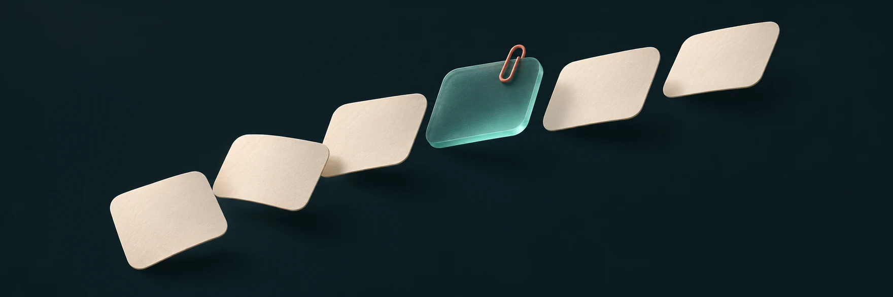
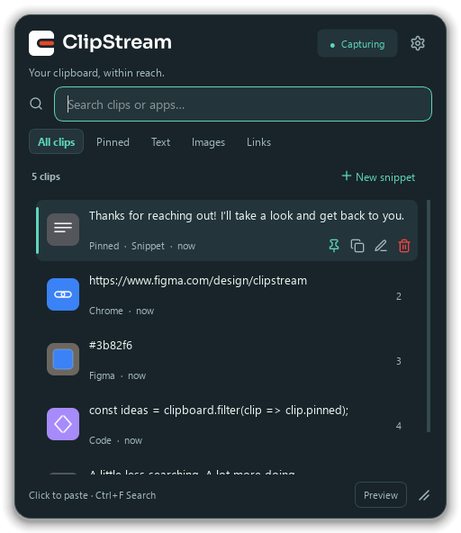
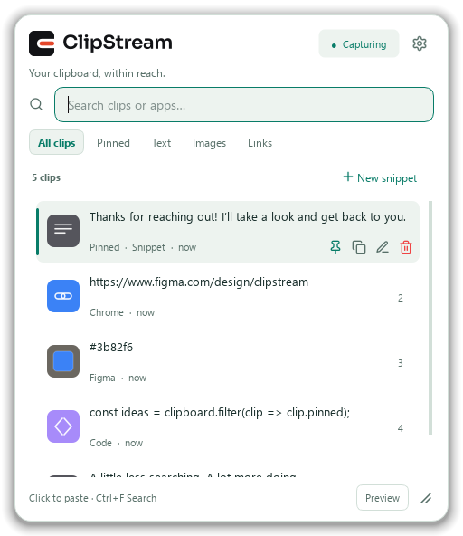
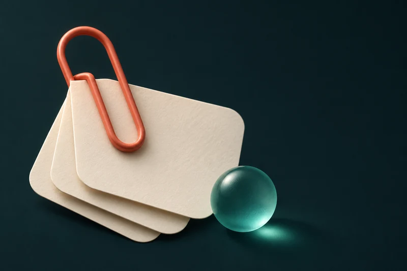

<p align="center">
  <picture>
    <source media="(prefers-color-scheme: dark)" srcset="resources/readme-logo-dark.svg">
    
  </picture>
</p>
<h1 align="center">Good ideas deserve a second paste.</h1>
<p align="center">Your clipboard, with a memory.<br>A small, native Windows app for everything you meant to keep.</p>
<p align="center">
  <a href="https://github.com/Razee4315/clipstream/releases/latest"><strong>Download for Windows →</strong></a>
  &nbsp; · &nbsp; <a href="docs/releases/0.3.4.md">What’s new in v0.3.4</a>
  &nbsp; · &nbsp; <a href="#make-it-muscle-memory">Keyboard shortcuts</a>
</p>
<p align="center">
  
  
  <a href="LICENSE"></a>
</p>
<p align="center">
  
</p>

## Copy something. Keep going.

That link you copied three things ago. The reply you type every day. The code snippet you were about to lose. ClipStream keeps them close, so you can stay with what you’re doing.

| 01 · Copy | 02 · Find | 03 · Paste |
| :--- | :--- | :--- |
| Copy text, links, or an image as usual. | Press **Ctrl+Shift+V**. Browse, filter, or search. | Click a clip or press **Enter** to paste into your original app. |

**[Get the Windows installer](https://github.com/Razee4315/clipstream/releases/latest)** — install it once; ClipStream lives in your system tray.

## A little window. A lot within reach.

The popup opens beside your text cursor without taking focus from your app. Search when you need to; paste when you’re ready. Your original selection stays in place.

<table>
  <tr><td align="center"><strong>After hours</strong></td><td align="center"><strong>In the daylight</strong></td></tr>
  <tr>
    <td></td>
    <td></td>
  </tr>
</table>

*Real app captures. Choose from eight theme options, including System.*

**Make room for your workflow.** Drag the header to move the popup. Pull the bottom-right grip to resize it. ClipStream remembers the size when you close it. Compact and Comfortable presets are available in Settings.

## Keep the things you reach for twice.

<table>
  <tr>
    <td width="55%">
      <h3>Your best replies, ready to go.</h3>
      <p>Pin a useful clip or save a reusable snippet. Keep an address, a support reply, or a bit of code close at hand.</p>
      <p><strong>Find the right thing faster.</strong><br>Search clip text or source apps. Filter to pinned items, text, images, or links.</p>
      <p><strong>Give it a quick polish.</strong><br>Preview the full clip, change text case, trim whitespace, or paste a calculation result.</p>
    </td>
    <td width="45%"></td>
  </tr>
</table>

## Your history stays on your device.

Pause capture whenever you want. Exclude apps, choose retention limits, and skip detected secrets. Clips marked private by password managers are never captured.

Secret detection is best-effort; exclude sensitive apps for stronger control. You can clear ordinary history while keeping your pinned snippets.

## Make it muscle memory

| Do this | Press this |
| :--- | :--- |
| Open or close your clipboard | **Ctrl+Shift+V** |
| Move through clips / paste | **↑ ↓** / **Enter** |
| Paste one of the first nine clips | **Ctrl+1–9** |
| Search | **Ctrl+F** |
| Preview the full clip | **Ctrl+Space** |
| Pin or unpin | **Ctrl+P** |
| Save a new snippet | **Ctrl+N** |
| Choose a paste format | **Shift+Enter** |

<details>
<summary><strong>A few more shortcuts & useful details</strong></summary>

**Ctrl+O** opens a link or file · **F2** edits · **Shift+Delete** deletes · **Esc** closes.

Typing goes to your app until you press **Ctrl+F** or click the search field. If an app doesn’t report its text cursor, the popup opens near your mouse pointer instead.

Windows prevents a normal app from pasting into one running as administrator. In that case, ClipStream leaves the item copied and asks you to press **Ctrl+V**.

</details>

<details>
<summary><strong>Build it yourself</strong> · C++17 / Qt 6</summary>

Requires Qt 6 with Widgets, SQL, SVG, and Test, plus CMake and a matching C++ kit. For the Windows MinGW kit, put Qt, MinGW, and Ninja on `PATH`.

```powershell
cmake -S . -B build -G Ninja -DCMAKE_BUILD_TYPE=Release -DCMAKE_PREFIX_PATH="C:/Qt/6.11.1/mingw_64"
cmake --build build
ctest --test-dir build --output-on-failure
```

Tests use temporary history and an offscreen clipboard. Screenshots are saved in `build/artifacts/`; test results are in `build/test-results.txt`. Separate Windows desktop checks exercise real focus and paste behavior. See [Contributing](CONTRIBUTING.md).

</details>

---

<p align="center"><strong>Less hunting. More doing.</strong><br><a href="https://github.com/Razee4315/clipstream/releases/latest">Get ClipStream for Windows →</a></p>
<p align="center">Made by <a href="https://www.linkedin.com/in/saqlainrazee/">Saqlain Abbas</a> · <a href="LICENSE">MIT</a> · <a href="CHANGELOG.md">Changelog</a> · <a href="https://github.com/Razee4315/clipstream/issues">Report a bug</a></p>
